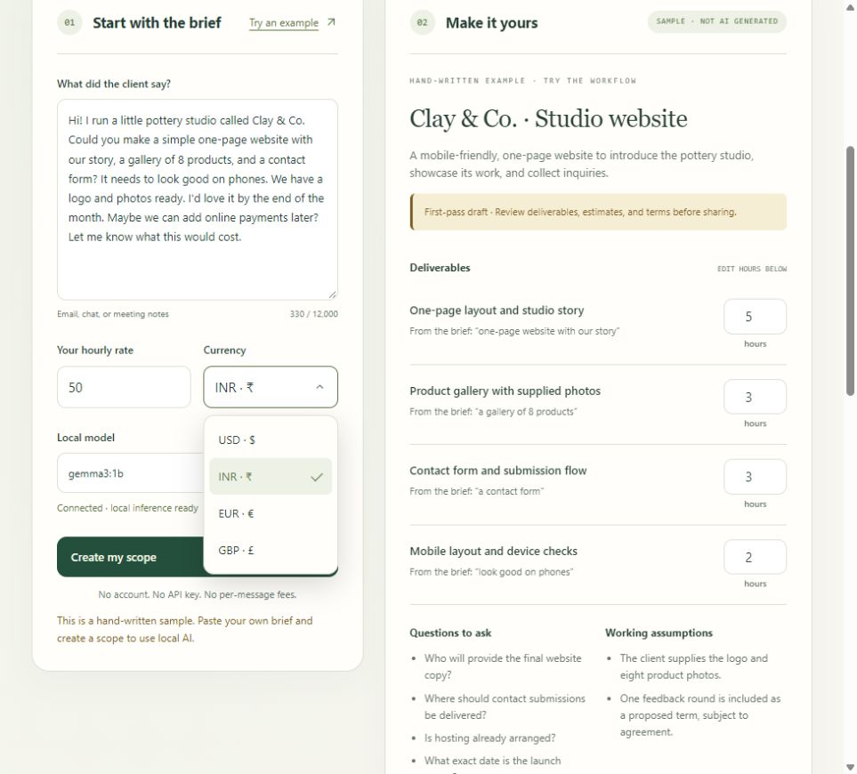
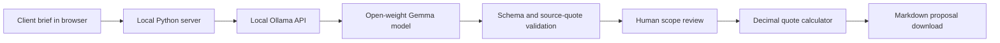

# ScopeKit

**Messy brief. Clear next step.**

A small local AI workbench for freelancers: paste a client message, extract a source-linked scope, review suggested hours, calculate a quote, and export a Markdown proposal with a client reply.

Built for the [Hacktoberfest Open-Source AI Challenge: Week 2 — Side Hustle](https://dev.to/challenges/hacktoberfest-week2-2026-10-12), October 2026.



[View the verified real Gemma run](evidence/gemma-ui.png).

## Start in a minute

Requires **Python 3.10+**. No Python packages, Node, build step, account, or paid API key required.

On Windows, double-click **start.cmd** to open the app and start an available local Ollama runtime. The launcher reuses an existing Ollama server. It also detects the portable runtime in this workspace; that runtime and its model files are not included in the source ZIP. Closing the launcher stops an Ollama process only if the launcher started it. Or, run just the app server from this folder:

```sh
python app.py
```

Open **http://127.0.0.1:8765**. Click **Try an example** to explore the complete editing and export workflow immediately. The example is hand-written and clearly labeled; it does not use AI.

### Enable real local AI

1. Install [Ollama](https://ollama.com/download) and start it.
2. Use Ollama 0.6 or newer, then download the model once:

   ```sh
   ollama pull gemma3:1b
   ```

3. If Ollama is not already serving, run `ollama serve` in another terminal.
4. In ScopeKit, click **Check connection**, paste your own brief, and **Create my scope**.

The default model is about 806 MB. Hardware affects generation time, and the first request may take several minutes. Larger local models such as `gemma3:4b` can be pulled and selected for better results. ScopeKit does not download models automatically. If the port is busy, use `python app.py --port 8766` and open the printed address.

## What it does

- Extracts requested deliverables with Gemma, then attaches verbatim source passages through deterministic task-word matching.
- Suggests hours, assumptions, exclusions, and clarifying questions for review.
- Rejects malformed outputs, unmatched task names, duplicate task anchors, and invalid source quotes, with one bounded correction attempt.
- Uses Gemma-compatible user turns and records the selected model in real-generation exports.
- Calculates hourly totals, contingency, deposit, and balance using decimal arithmetic.
- Lets you change hours, rate, currency (USD, INR, EUR, GBP), and proposed terms.
- Produces an editable client reply and a downloadable Markdown proposal.
- Keeps all working content in memory. Refreshing or closing the page clears it.

**Review every AI suggestion.** Source linking uses task-word overlap and a small set of aliases (such as phones/mobile). It is a traceability heuristic, not proof that a deliverable is interpreted correctly, complete, or free from overlap. Hours are guesses, not a commitment; deadlines are deliberately left for client confirmation. The app does not send emails, take payments, generate invoices, calculate tax, or persist client records. A manually edited reply is preserved when prices change, with a visible reminder to review its numbers. Use **Refresh reply from current quote** to rebuild it from the current values.

## Why open innovation matters

The core workflow uses the open-weight **Gemma 3 1B** model through the open-source **Ollama** runtime. Local inference means no client brief has to be uploaded to a commercial inference API, no per-request fee, and no provider account. The user can replace the model independently of the app. App source is MIT licensed; [Gemma 3 uses Google’s Gemma Terms](https://ai.google.dev/gemma/terms), and [Ollama is MIT licensed](https://github.com/ollama/ollama/blob/main/LICENSE). Model weights and Ollama are separate downloads, not bundled in this repository.

Potential customer: independent web designers or small freelance studios that repeatedly turn informal requests into proposals. A possible business model is paid installation, customization, and a branded proposal workflow. **Willingness to pay is an untested hypothesis; no users, sales, or savings are claimed.**

## Architecture



Only `127.0.0.1` is used by the app server and inference adapter. No analytics, CDNs, remote fonts, cookies, or cloud inference. Only the appearance preference is saved in browser local storage; client briefs and proposals stay in memory. Host and Origin checks restrict cross-origin access, static files use an explicit allowlist, and the UI inserts model text as text rather than HTML. Run this as a personal local tool, not a public production server. Ollama itself has its own settings and behavior; use downloaded local models for offline operation.

Files: `app.py` is the server, validator, Ollama adapter, and calculator. `launch.py` starts the app and an available local runtime. `static/` is plain HTML/CSS/JavaScript. `tests/` contains meaningful validation and HTTP integration tests. `SUBMISSION.md` is a local editable DEV entry draft and demo script.

## Verification

```sh
python -m unittest discover -s tests -v
node --check static/app.js
```

All **19 automated tests pass**. They use a mock local Ollama endpoint to verify the adapter and failure cases. Separately, a real CPU-only Gemma 3 1B run passed through the actual ScopeKit API; its response and model digest are saved in `evidence/gemma-run.json`. The recorded warm run took 3.26 seconds on this device; it is one smoke test, not a performance or accuracy benchmark. The model proposed implausibly low hours, so reviewing estimates remains necessary. See `VERIFICATION.md` for the observed limits.

Manual smoke test:

1. Try the sample: 13 hours × $50 + 15% contingency = **$747.50**, with a **$373.75** deposit.
2. Change hours/rate/currency and check that the quote and untouched reply recalculate.
3. Edit the reply, change the rate, and verify your reply edits are preserved.
4. Export and verify the Markdown includes the reviewed numbers and your reply.
5. Generate from an original brief with Gemma through Ollama. Check each source quote and correct estimated hours.

## Community research

[AI Explore’s “Structured Output Gives You Syntax. It Doesn't Give You Semantics”](https://dev.to/aiexplore369zoho/structured-output-gives-you-syntax-it-doesnt-give-you-semantics-3c13) and its discussion informed the source-evidence checks and mandatory human review. [Nearshi’s “Clean JSON Extraction with Ollama and Python”](https://dev.to/nearshi/-clean-json-extraction-with-ollama-and-python-21f3) documents parsing failures; ScopeKit uses [Ollama’s documented schema format](https://docs.ollama.com/capabilities/structured-outputs) plus application validation rather than relying only on prompt wording.

## Sponsor and submission readiness

Gemma is the target sponsor integration: it performs the actual scope extraction, while the arithmetic remains deterministic. Running locally is explicitly permitted by the [Week 2 Gemma category](https://dev.to/challenges/hacktoberfest-week2-2026-10-12). Real model-run evidence is included in `evidence/gemma-run.json`; a public video or deployed demo is still needed for submission.

`.github/workflows/checks.yml` adds useful GitHub Actions automation: Python 3.10/3.13 tests on Windows and Linux, plus JavaScript syntax validation. It runs on pushes and pull requests. Check the [Actions page](https://github.com/Kushaal-k/ScopeKit/actions) for execution results. The Week 2 page lists Actions automation under its GitHub Copilot category; any entry must describe the Actions use accurately and must not claim Copilot authored the project.

See `SPONSOR-AUDIT.md` for all category decisions, available offers, and the deadline discrepancy. The local DEV draft now follows the official template and includes both required tags: `devchallenge`, `hf26challenge`.

## Contribute

Start with an issue describing an actual brief the tool handles badly; remove client identifiers first. Add a regression test for validation or quote changes and run the checks above. Useful small contributions: alternative sample briefs, improved keyboard flow, and clearer model failure messages. Avoid sending real client content in issues.

## License and disclosure

MIT. Created with AI coding assistance. The sample scenario is fictional. No customer outcome or real inference result is represented by the demo fixture.

### Appearance

Use the Theme selector in the header to choose Light, Dark, or System. Your choice is saved in this browser; System follows your device preference. Only the appearance preference is persisted, not client briefs.
