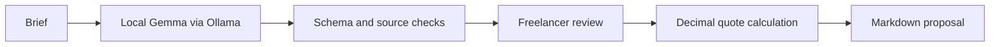

*This is a submission for the [Hacktoberfest Open-Source AI Challenge Week 2: Side Hustle](https://dev.to/challenges/hacktoberfest-week2-2026-10-12).*

LOCAL DRAFT — complete the demo link below before publishing. AI disclosure: `some_ai`.

## What I Built

ScopeKit turns an informal client message into a draft scope and proposal for a freelancer. Google's open-weight Gemma model extracts deliverables, source excerpts, missing details, working assumptions, and suggested exclusions. The freelancer reviews the hours, sets a rate, and exports a Markdown proposal with an editable reply.

The intended customer is an independent designer or small freelance studio that repeatedly receives requests like “just a simple website.” A client needs to understand what the price includes; a freelancer needs enough clarity to estimate the work. ScopeKit makes that conversation easier to start.

A possible business is paid setup and customization of a branded proposal workflow. Willingness to pay has not been tested, and I am not claiming customers or sales.

## Demo

TODO before publishing: add a short video using the verified **real Gemma generation**, followed by a reviewed quote and exported proposal. Real run data is included in `evidence/gemma-run.json`. The supplied sample is fictional, hand-written, and visibly labeled. It is useful for exploring the interface, but is not evidence of model performance.

Recording sequence:

1. Paste a fresh client brief and select `gemma3:1b`.
2. Generate a scope and show the source excerpts and unanswered questions.
3. Correct an estimated number of hours and show the recalculated quote.
4. Edit the reply, then change the rate to show the reminder to check prices.
5. Export the proposal and open its Markdown text.

## Code

[Source code on GitHub](https://github.com/Kushaal-k/ScopeKit). The project includes a README, MIT license, automated tests, and a GitHub Actions workflow.

## How I Built It

The UI is plain HTML, CSS, and JavaScript. A dependency-free Python server connects to Ollama on loopback. Gemma 3 1B is the default small, text-only model. Its instructions and the brief are passed in a user turn, consistent with Gemma's prompt format, while Ollama applies the chat template.

Gemma generates a schema-constrained object of tasks and questions. The app attaches verbatim source passages using task-word overlap, with a few aliases such as phones/mobile. It validates the resulting shape, hour ranges, source excerpts, and task anchors. If the first response is invalid, one correction request includes the validation failure. A second failure is surfaced rather than disguised as a successful result. Source excerpts help trace a suggestion; they cannot prove the model interpreted it correctly.

After human review, Python's Decimal arithmetic calculates the rate, contingency, deposit, and balance. The model does not calculate the money. Edited replies are preserved when quotes change and visibly flagged for review. Real-generation exports record the selected model.

Tests exercise pricing, malformed output, invented evidence, bounded retry, the local API, and the Ollama HTTP adapter with a mock server. GitHub Actions is configured to run Python checks on Windows and Linux, plus JavaScript syntax checks. It still needs its first run in a public repository. A real Gemma run also completed through the app API: the model identified the website, gallery, and contact form. Its suggested hours were too low, so they needed review. The recorded warm API run took 3.26 seconds on this CPU-only device. That single result is a smoke test, not a benchmark. Source matching is a heuristic and does not establish completeness or semantic correctness.

## Why Does Open Innovation Matter?

Open-weight Gemma makes the central extraction workflow available on the user's computer. A downloaded local model avoids sending client briefs to a hosted inference service and avoids a per-request API charge. Users can inspect the prompt and replace or adapt the model without rewriting the application. Local hardware still costs money and affects latency; model suggestions still need review.

The application is MIT licensed. Gemma 3 uses [Google's Gemma Terms](https://ai.google.dev/gemma/terms); the model weights are not MIT or Apache licensed and are not bundled with the project. [Ollama is MIT licensed](https://github.com/ollama/ollama/blob/main/LICENSE).

[AI Explore's article and discussion on structured output](https://dev.to/aiexplore369zoho/structured-output-gives-you-syntax-it-doesnt-give-you-semantics-3c13) informed the source checks and explicit human review. A valid JSON object is only the start of a trustworthy workflow.

## Prize Categories

**Planned: Best Use of Gemma.** Gemma performs the brief extraction at the core of the product. A successful real API run is recorded in the evidence folder; add a public demo recording before publishing.

**Possible after execution: Best Use of GitHub Copilot, through GitHub Actions automation.** The Week 2 page explicitly includes Actions automation in this category. A cross-platform workflow is prepared, but has not run on GitHub. Describe it as Actions automation and link a successful run if entering; do not imply Copilot was used to author the app.

## AI Disclosure

The project and write-up were created with AI coding and writing assistance. No first-user results, sales, or benchmark improvements are claimed.

---

Private preparation notes — remove before publishing:

- Both official template tags are required: `devchallenge`, `hf26challenge`.
- DEV's challenge rules say **18 October 2026 at 11:59 PM PDT = 19 October at 12:29 PM IST**. The MLH mirror currently ends one day earlier; see `SPONSOR-AUDIT.md`. Submit early.
- Real Gemma API generation is complete. Add public source/demo links and a video recording of the reviewed workflow.
- Replace preparation language with actual observations after the demo; do not invent them.
- Run the prepared GitHub Actions workflow before adding its category to the entry.
- Optional first-user and agent-session sections were omitted because no evidence is available. Add them only after actual use or an explicitly authorized transcript save.
- No publication, code claim, skill installation, domain registration, or prize entry has been performed.
